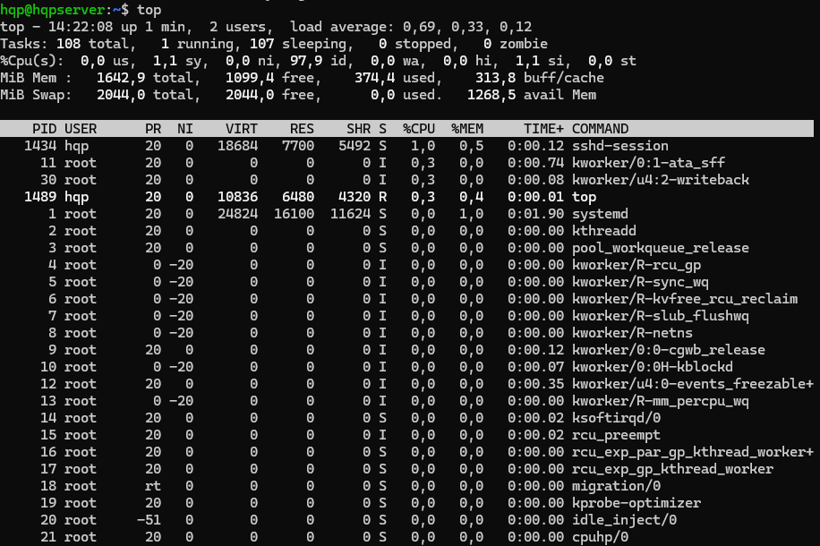
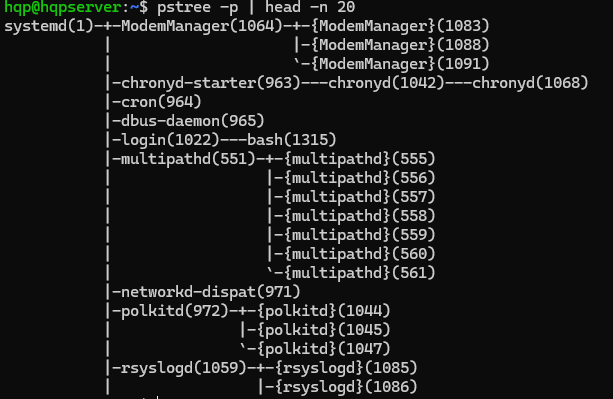
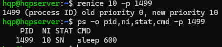
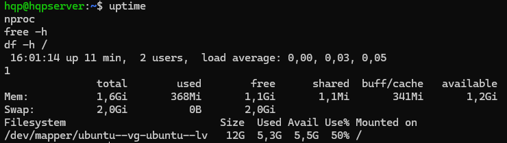
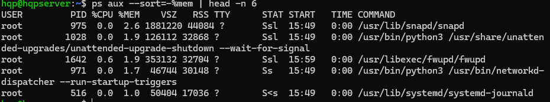
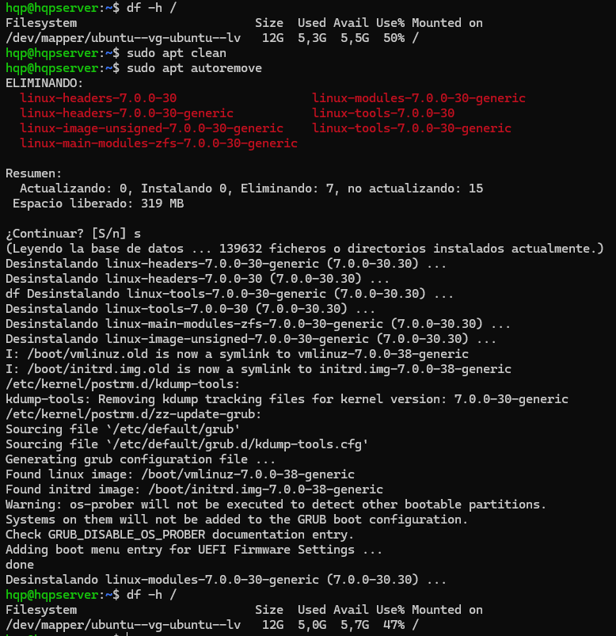
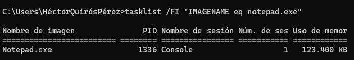
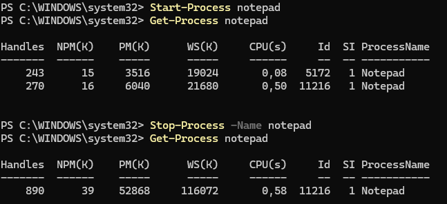
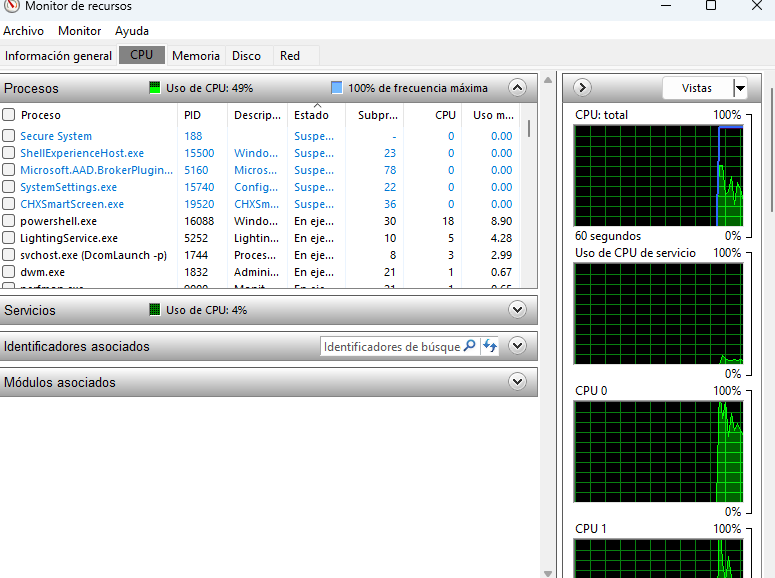
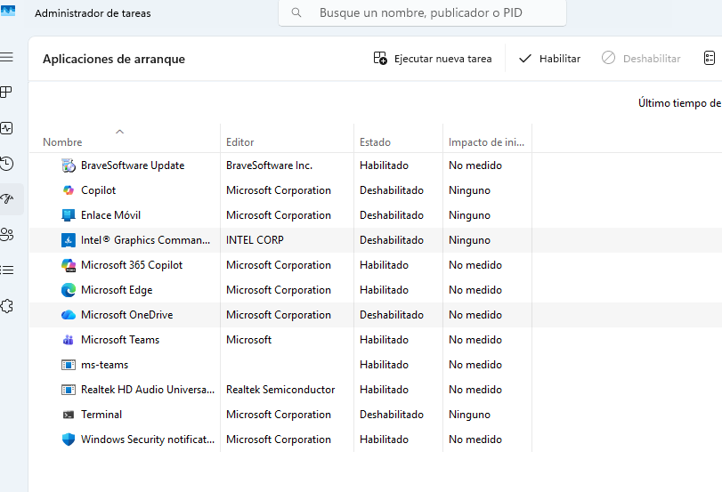

# Gestión de procesos y optimización del rendimiento en Linux y Windows

Administración de procesos y servicios, y detección de cuellos de botella en **Ubuntu Server** y **Windows 11**, con herramientas gráficas y de línea de comandos.

Prácticas de la unidad *Procesos del sistema* de *Administración de Sistemas Operativos* (2º ASIR).

## Gestión de procesos

| Tarea | Linux | Windows |
|---|---|---|
| Ver procesos | `ps aux`, `top`, `pstree -p` | Administrador de tareas, `tasklist` |
| Buscar uno concreto | `ps -o pid,ni,stat,cmd -C sleep` | `tasklist /FI "IMAGENAME eq notepad.exe"` |
| Segundo plano | `comando &`, `jobs` | `Start-Process` |
| Cambiar prioridad | `nice -n 15`, `renice 10 -p PID` | Detalles > Establecer prioridad |
| Finalizar | `kill PID`, `kill %1` | `taskkill /IM notepad.exe`, `Stop-Process -Name notepad` |
| Servicios | `systemctl status cron` | Monitor de recursos, `services.msc` |

## Optimización del rendimiento

1. **Identificar el cuello de botella**: carga, CPU, memoria y disco (`uptime`, `nproc`, `free -h`, `df -h`; pestaña Rendimiento en Windows).
2. **Procesos que más consumen**: `ps aux --sort=-%mem`.
3. **Programas de inicio y servicios innecesarios**: aplicaciones de arranque en Windows; `systemctl list-unit-files --state=enabled` y `systemctl disable --now SERVICIO` en Linux.
4. **Prioridad de tareas pesadas**: lanzarlas con `nice` para que no compitan con el resto.
5. **Tareas fuera de horario**: programarlas con `cron`, por ejemplo una limpieza semanal de miniaturas antiguas:
   ```
   0 3 * * 0 find ~/.cache/thumbnails -type f -mtime +30 -delete
   ```
6. **Liberar espacio**: `apt clean`, `apt autoremove` y Liberador de espacio en disco.
7. **Mantener el sistema actualizado**: `apt list --upgradable`, Windows Update.

El script [`diagnostico.sh`](diagnostico.sh) agrupa en una sola salida las comprobaciones de los pasos 1 a 3 y las actualizaciones pendientes.

```bash
./diagnostico.sh
```

## Evidencias

**Linux**

| | |
|---|---|
|  |  |
| `top` | Árbol de procesos |
|  |  |
| Cambio de prioridad con `renice` | Carga, memoria y disco |
|  |  |
| Procesos ordenados por memoria | `apt autoremove` y espacio liberado |

**Windows**

| | |
|---|---|
|  |  |
| `tasklist` con filtro | `Start-Process` / `Stop-Process` |
|  |  |
| Monitor de recursos | Aplicaciones de arranque |

El resto de capturas están en [`capturas/`](capturas/).
